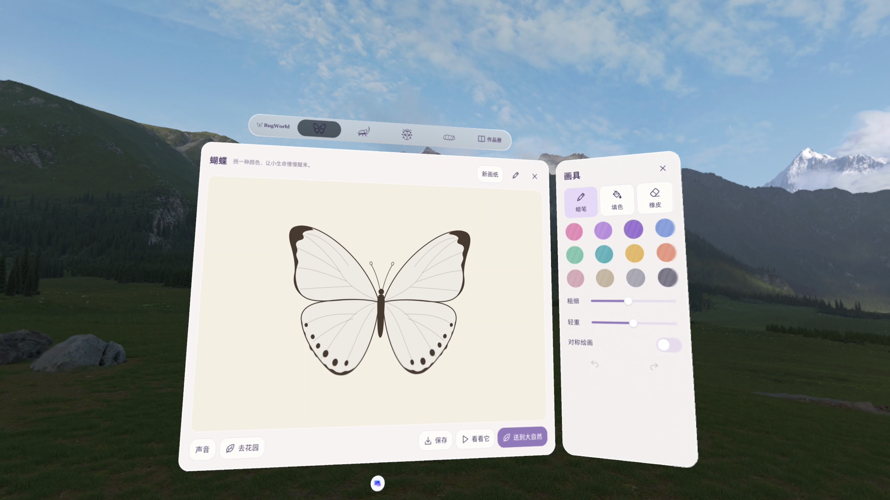
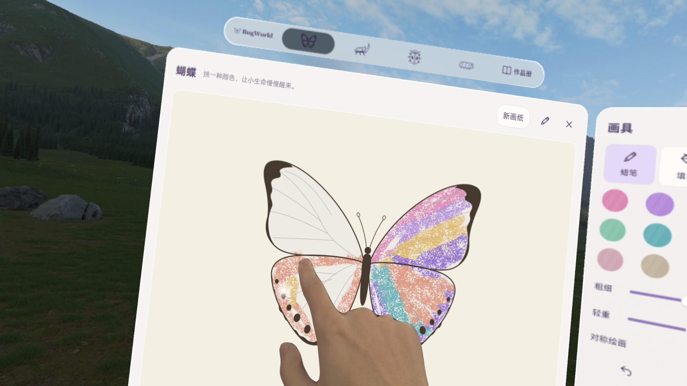
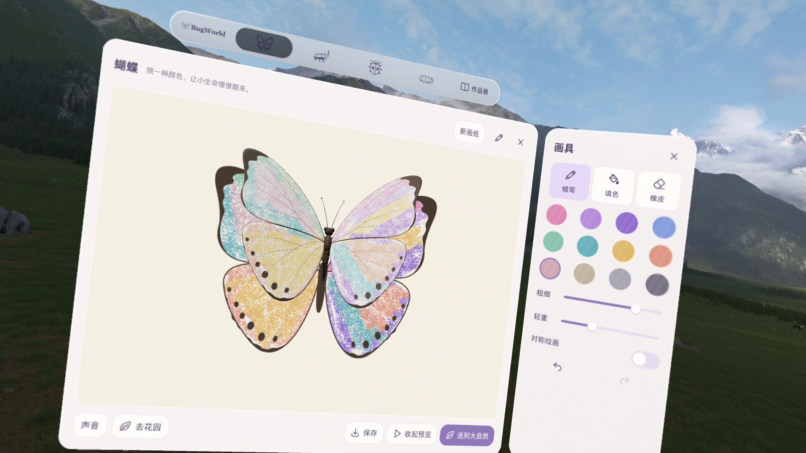
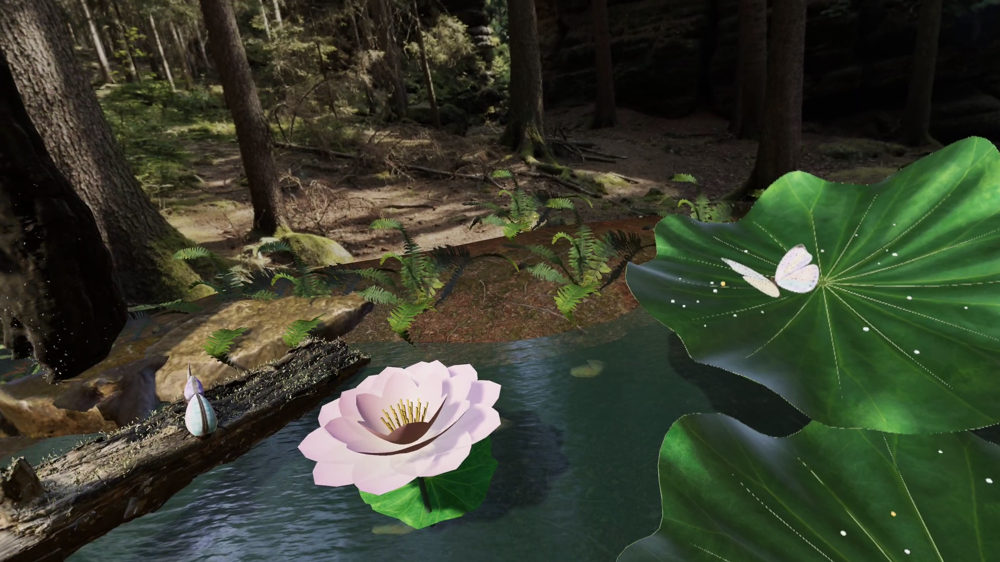
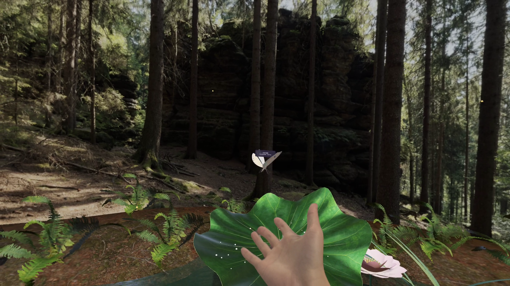

# BugWorld

English | [简体中文](README.md)

**Color an insect. Watch it come to life in a forest around you.**

BugWorld is a spatial creativity and relaxation app for PICO devices. Paint with your fingertips, see your artwork become a 3D insect, and enter a forest to watch it crawl and fly—or invite it closer to your hand.

*Promotional illustration. Actual app footage is shown in the screenshots below.*

## What you can do

- **Create your own insects:** eight coloring sheets—butterfly, rhinoceros beetle, ladybug, caterpillar, dragonfly, honeybee, worker ant, and grasshopper—with 20 crayon colors, fill, eraser, mirror drawing, and undo/redo.
- **See your artwork in 3D:** preview your colored insect in front of the canvas. Pinch and rotate your wrist to inspect it from different angles.
- **Visit your forest:** send your creations into nature and watch them move along branches, across lotus leaves, and through the air. The garden holds up to ten insects at a time.
- **Interact with your hands:** look at a flying insect, pinch to select it, then open your palm to invite it closer for a visit.
- **Keep your creations:** browse, edit, delete, and send saved artwork back into the garden from your album.
- **Unwind:** enjoy a single-player experience with music, nature sounds, and Chinese and English interfaces.

## In-headset screenshots

These frames come directly from a headset recording made on November 3, 2026, showing the interface and environment from that version.

| Spatial canvas | Finger painting |
| --- | --- |
|  |  |
| 3D insect preview | Forest garden |
|  |  |

## Technology

| Area | Stack |
| --- | --- |
| Application | Kotlin, Android, Gradle |
| Spatial UI and input | PICO Spatial SDK 6.1.0; native spatial windows and eye/hand interaction |
| Environment and characters | PICO native scenes, GLB models, skeletal animation, and materials |
| Asset creation | Blender and Python asset tools |

## Try it

1. Use a PICO device compatible with this app's PICO Spatial SDK 6.1.0 requirements and enable hand tracking.
2. Obtain the **1.0.21 APK** from the maintainer and sideload it using your device's app installation tools. Preview builds are currently supplied by the maintainer; request one through this repository's [Issues](https://github.com/dragongyke/BugWorld/issues).
3. Open BugWorld, choose a coloring sheet, paint with your fingertip, and select **Preview**.
4. Select **Set free** to enter the forest. Use the return-to-canvas object in the scene whenever you want to create again.

## License

Original code, documentation, and assets are available under [MIT](LICENSE). Third-party assets and SDKs retain [their own licenses](THIRD_PARTY_NOTICES.md).
