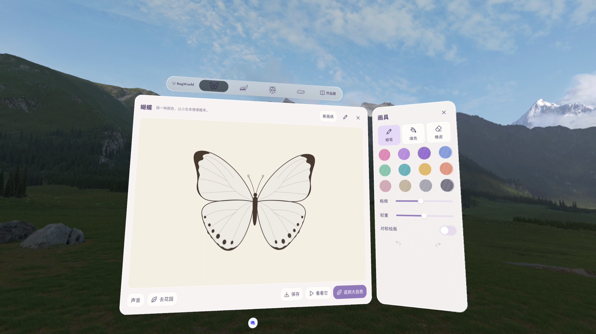
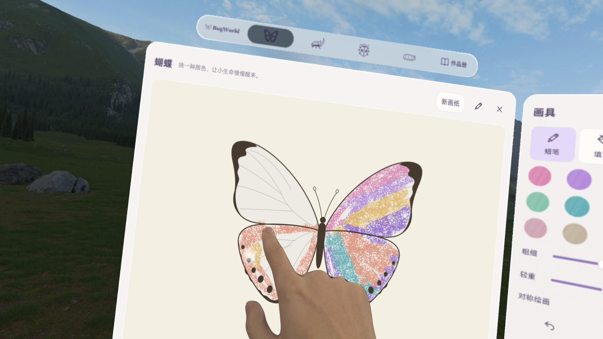
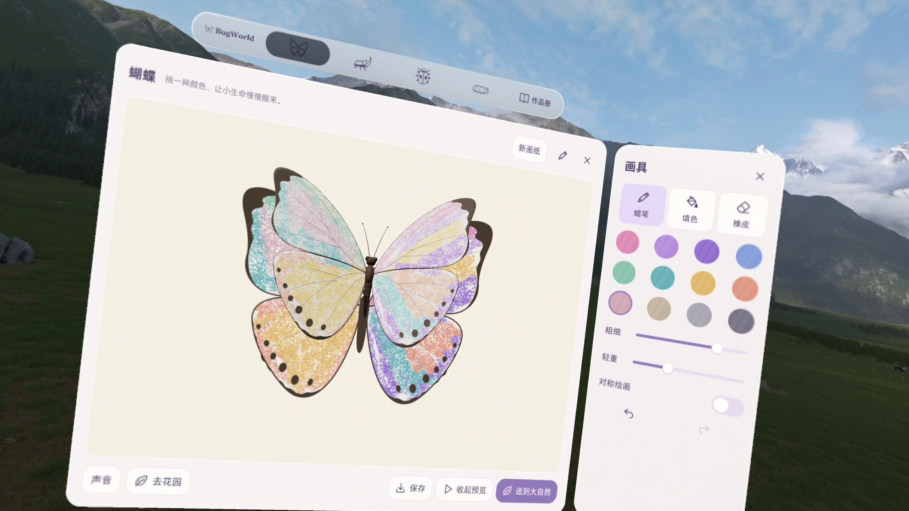
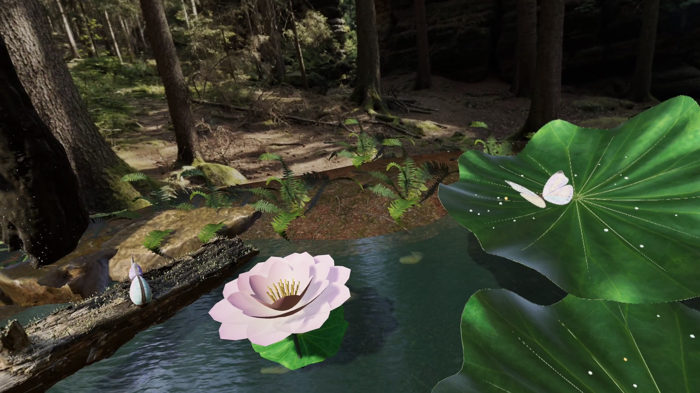
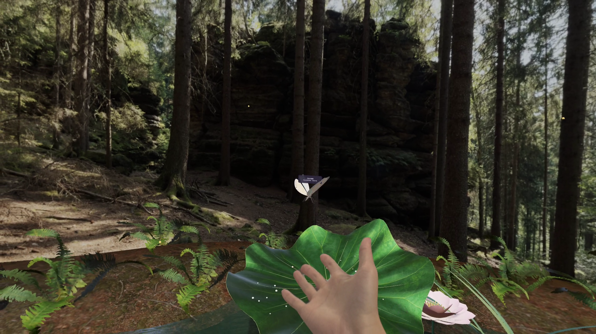

# BugWorld · 我的昆虫世界

[English](README.en.md) | 简体中文

**给昆虫涂上自己的颜色，让它在身边的森林里醒来。**

BugWorld 是一款为 PICO 空间设备打造的创作与治愈应用。你可以用手指涂色，欣赏画作变成立体昆虫，再进入森林，静静观察它们爬行、飞舞，或邀请它们靠近手掌。

*主题宣传插画。实际应用画面见下方实机截图。*

## 可以做什么

- **画出自己的昆虫**：蝴蝶、独角仙、瓢虫、毛毛虫、蜻蜓、蜜蜂、工蚁和蚱蜢，八种画纸搭配 20 色蜡笔、填色、橡皮、对称绘画与撤销/重做。
- **让画作立体呈现**：在画板前预览保留自己配色的 3D 昆虫，捏住并转动手腕，从不同角度观察。
- **走进自己的森林**：把作品送入自然场景，欣赏昆虫在树干、荷叶和空中活动。花园最多同时容纳十只昆虫。
- **用手与它们互动**：凝视选择目标，捏合可飞的昆虫并摊开手掌，邀请它飞近、停留。
- **收藏创作**：在作品册中浏览、继续编辑、删除画作，或再次将作品送入花园。
- **轻松陪伴**：单机体验，支持中英文，配有背景音乐与自然环境声。

## 实机截图

以下画面直接取自 2026-11-03 的实机录屏，展示当时版本的界面与场景。

| 空间画板 | 手指涂色 |
| --- | --- |
|  |  |
| 3D 昆虫预览 | 森林花园 |
|  |  |

## 技术栈

| 部分 | 技术 |
| --- | --- |
| 应用 | Kotlin、Android、Gradle |
| 空间界面与输入 | PICO Spatial SDK 6.2.8；原生空间窗口、眼手交互 |
| 场景与角色 | PICO 原生场景、GLB 模型、骨骼动画与材质 |
| 资产制作 | Blender、Python 资产处理工具 |

## 如何体验

1. 准备兼容本应用 PICO Spatial SDK 6.2.8 的 PICO 设备，并开启手部追踪。
2. 获取维护者提供的 **1.0.22 APK**，通过设备的应用安装工具侧载。当前体验包由维护者提供，可通过本仓库 [Issues](https://github.com/dragongyke/BugWorld/issues) 联系获取。
3. 打开「我的昆虫世界」，选择画纸，用手指涂色，点击「看看它」预览。
4. 点击「送到大自然」进入森林；想继续创作时，选择场景中的返回画板入口。

## 许可证

原创代码、文档与资产采用 [MIT](LICENSE)；第三方资产及 SDK 遵守[各自许可](THIRD_PARTY_NOTICES.md)。
