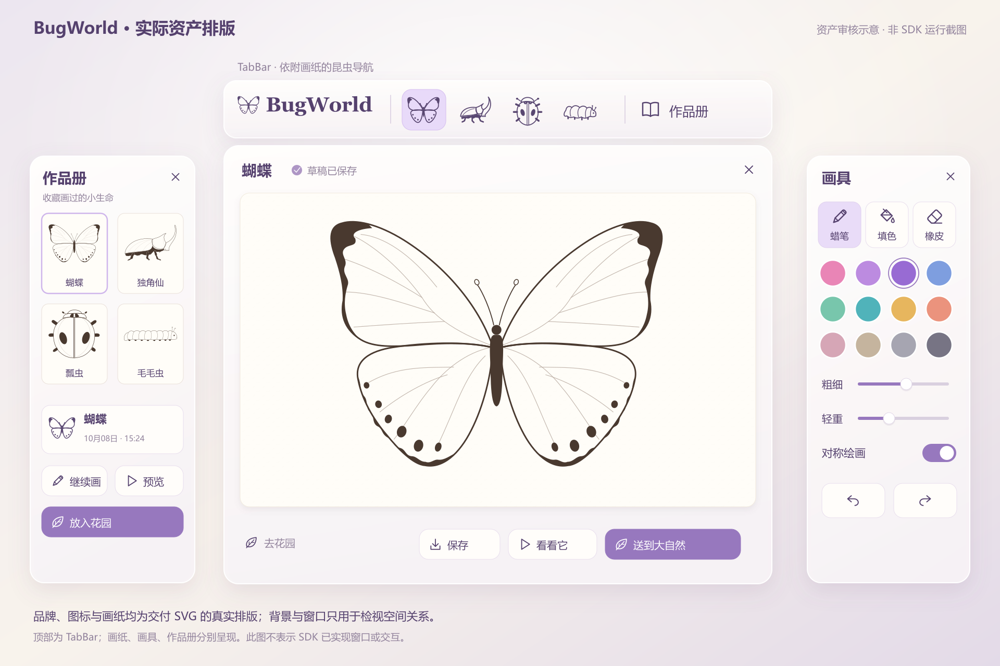
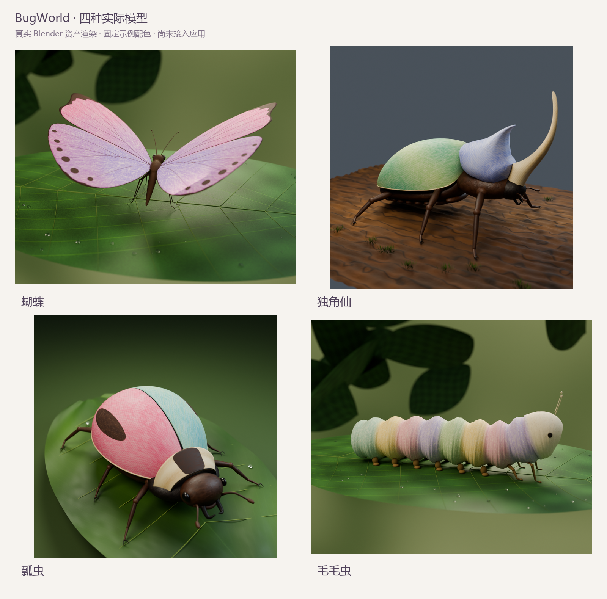
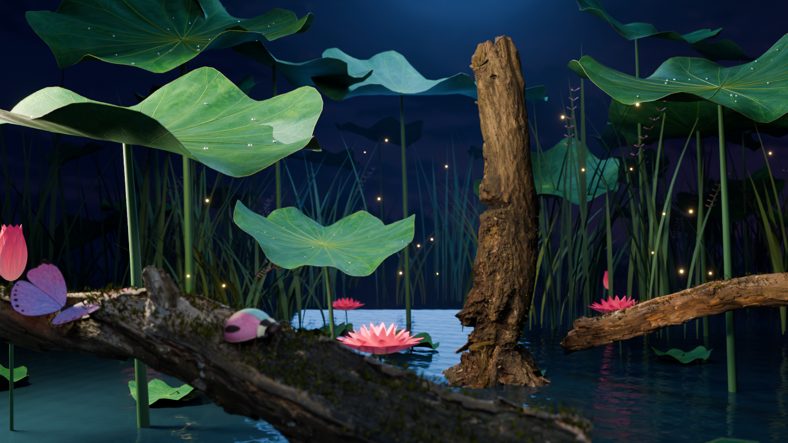

# BugWorld · 实际资产审核

本轮按已确认设计制作资产，先自行对照，再交用户确认。**用户于 2026-10-09 明确确认整批资产并授权接入应用**；当前接入结果见 [V3 实施结果](V3-Implementation-Results.md)。下方保留资产制作阶段的对照证据与效果边界。

## 依据与交付

- [线稿基准](visual-redesign/2026-10-08/01-insect-sheets-v1.png)：四种轮廓、斑点、比例。
- [UI 基准](visual-redesign/2026-10-08/04-shared-space-multiwindow-v2.png)：图标清晰度、暖白浅紫视觉。应用顶部已接入 SDK `TabBar`。
- [模型基准](visual-redesign/2026-10-08/Model-Review.md)：四种昆虫的立体结构、手绘图案与自然材质。
- [场景基准](visual-redesign/2026-10-08/03-stage-lotus-v1.png)：蓝紫荷塘、巨型荷叶、枯木苔藓、暖粉荷花、微光与水面层次。
- 新资产位置：`assets-src/v3-review/`。可编辑 SVG / Blender 源文件、PBR 纹理、GLB、实际渲染及检查记录分开保存。

## 自检门槛

| 对象 | 必须检查 |
| --- | --- |
| 画纸 | 与确认稿并排检查外轮廓、身体比例、固定斑点；闭合区域与透明背景可用 |
| 导航图标 | 按实际 48 / 64 / 96 像素观察；独立简化路径、足够线宽，不能直接缩小整张画纸 |
| 四种模型 | 中性光和自然环境下检查正面、侧面、背部；体积、关节、六足/腹足与原画特征一致 |
| 材质 | 蜡笔颗粒和留白可辨；甲壳、薄翅、软体、眼睛有不同粗糙度，避免整只均匀塑料高光 |
| 动画 | 检查静止、展开、飞行、收拢中间姿态；翼膜/甲片/身体不相穿，关节不断开 |
| 花园 | 轮廓和构图层次、自然植物尺度、树皮与苔藓细节、明暗关系、水面反射 |
| 导出 | GLB 实际导回检查几何、纹理、动画；渲染与源资产对比，不只检查导出成功 |

## 证据边界

- “实际渲染”来自本次真实模型或 GLB；概念图只作对照，不作交付截图。
- Blender 场景中的体积雾、世界环境光、面积灯、透光和后期微光，并不自动随 GLB 进入 PICO。
- 资产审核与头显画质/性能验收是两个阶段。本轮必须标明哪些效果需要后续引擎实现；不声称已经达到真机效果。
- 旧版运行模型和模板已在应用接入阶段删除；旧用户画作转换时保留原始文件。Git 历史用于追溯，不作为运行回退。

## 本轮结果

四种昆虫、线稿与 UI 资产已完成制作、内部对照和用户确认。荷塘样景已重新导入最终 GLB，完成独立环境和昆虫组合渲染；视觉对照仍单独记录，不把文件检查通过视为头显还原度通过。

**内部结论：可以提交本轮资产候选供用户审核。** 荷塘最新图经独立复核，没有发现明显透明黑片、严重穿插、断裂或大片缺材质；但荷叶/花瓣仍偏规整，背景芦苇重复感较强，暖色边光、蓝雾纵深与湿润质感弱于批准图。这些是实际差异，不能写成“已完整还原”。用户可以按类别确认或要求继续调整。

| 内容 | 本轮交付与已核实结果 |
| --- | --- |
| 线稿 | 四张可编辑 SVG、2048 透明 PNG、21 个闭合可涂区域；修正蝴蝶躯干、翅脉端点、瓢虫腿根/甲缝与独角仙腹缘 |
| UI 资产 | 四种小尺寸昆虫图标、品牌字标、十个工具图标；真实资产排版明确顶部 TabBar、中央画纸、右侧画具、左侧作品册 |
| 四种模型 | 每种提供 Blender / GLB / PBR 图像、中性光和自然布景图；本轮重新建立几何，没有拿第一版模型作替代 |
| 动画 | 每种五个动作，共 20 个片段；蝴蝶和毛毛虫通过新进程导入检查，甲虫类完成起飞/飞行 214 个半帧样本的表面相交检查 |
| 荷塘样景 | 实际植物、水面与扫描枯木/苔藓；独立环境 GLB 加本轮昆虫 GLB 的组合渲染；清除了黑底苔藓和不适合场景的白色主木候选 |
| 资产身份 | `asset-manifest.json` 记录交付候选路径与 SHA-256，后续接入必须明确使用这批文件 |

### 直接查看

- [并排审核页](../assets-src/v3-review/review.html)：每项左侧为已确认设计，右侧为实际输出。
- [UI 实际资产排版](../assets-src/v3-review/ui/boards/asset-layout-review.png) / [品牌和工具图标](../assets-src/v3-review/ui/boards/logo-and-tools-contact.png)。
- [四种线稿与批准稿对照](../assets-src/v3-review/lineart/comparison-approved-vs-svg.png)。
- [模型总览](../assets-src/v3-review/models-overview.png)。
- [荷塘实际组合渲染](../assets-src/v3-review/garden/garden-populated.png) / [独立环境回导](../assets-src/v3-review/garden/garden-roundtrip.png) / [场景检查记录](../assets-src/v3-review/garden/REVIEW.md)。
- [蝴蝶检查记录](../assets-src/v3-review/butterfly/REVIEW.md) / [独角仙检查记录](../assets-src/v3-review/beetle/REVIEW.md) / [瓢虫检查记录](../assets-src/v3-review/ladybug/REVIEW.md) / [毛毛虫检查记录](../assets-src/v3-review/caterpillar/REVIEW.md)。
- [荷塘来源与许可](../assets-src/v3-review/garden/ASSET-SOURCES.md)。
- [工时、PICO CLI 与 Token 统计](Implementation-Metrics.md)。

打包检查已通过：5 份 GLB、8 份画纸/昆虫图标 SVG、20 个动画片段；核对嵌入图像、材质、骨骼、回导报告哈希及苔藓透明通道。离线审核页的文件引用已检查；浏览器连接失败，未把网页交互标成已测。

## 实际资产预览

以下图片均由本轮可编辑资产生成。UI 是 SVG 排版板；模型和场景是 Blender 渲染。

### 应用接入后的边界

图中配色为审核样例；应用已按记录的 UV 契约更新玩家画作。场景表面路径、手部互动、音效和动画触发在应用中实现，其运行验证记录与本页 Blender 资产验证分开。

审核网格以细节为优先，尚未验收移动端 LOD、材质合批、纹理压缩及十只昆虫同场性能。荷塘预览是主观察方向的资产样景，完整环绕布置及实时光影需要应用阶段继续实现和逐图核验；不能直接把 Blender 渲染质量算成头显还原度。
