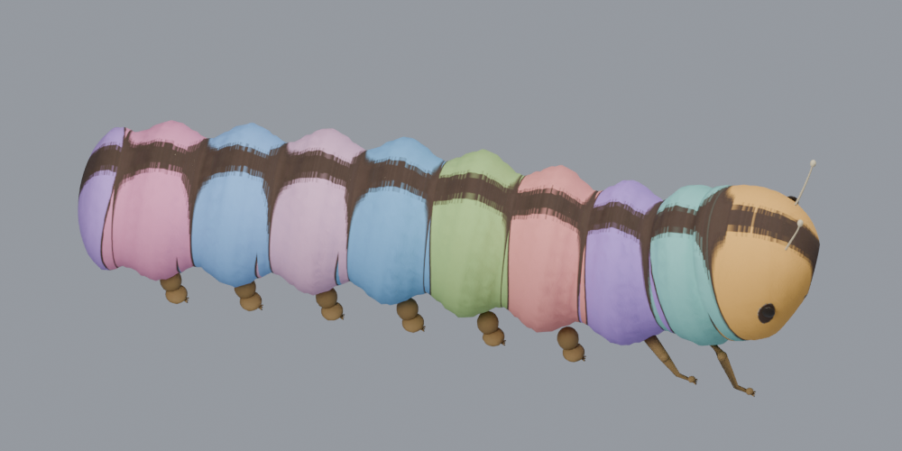
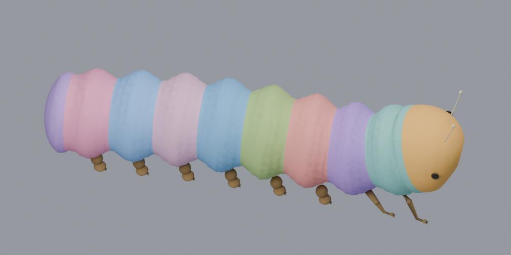

# 1.0.20 毛毛虫背部贴图修复

- 3D 身体不再合成画纸的固定黑色轮廓；保留玩家颜色、蜡笔笔触以及模型自身眼睛和足部。
- 头部锁定眼睛区域的颜色由同一分区邻近可涂像素补齐，避免去黑后留下纸色点。
- 画纸、模型几何、窗口生命周期和其他物种不变。Shared Space 与 Stage 共用修复。

## 对照证据

以下是**实际发布 GLB + Kotlin 运行时映射贴图的 Blender 渲染**，使用相同测试配色、灯光与机位，不是头显截图或用户原画。测试配色为纯色，蜡笔笔触保留由像素映射回归覆盖。

修复前：

修复后：

## 验证与交付

- 127 项单测通过；Lint 0 错误、35 警告；APK 构建成功。
- `deliverables/BugWorld-1.0.20.apk`，versionCode 20。
- SHA256：`0DC11953D11BF1E112209FAABD39F8600EA61E953497BECF2A8AEDD732625CE1`。
- ADB 保留数据覆盖安装成功，系统版本已核对。设备休眠，真机背部显示待确认。
- 可直接从作品册重新预览旧毛毛虫画作，无需重新绘画。待检查预览与 Stage 中背部是否无黑带、深色自绘笔触是否保留。
- 失败候选和根因记录在 `Troubleshooting-Retrospective.md`；阶段用量见 `Implementation-Metrics.md`。
