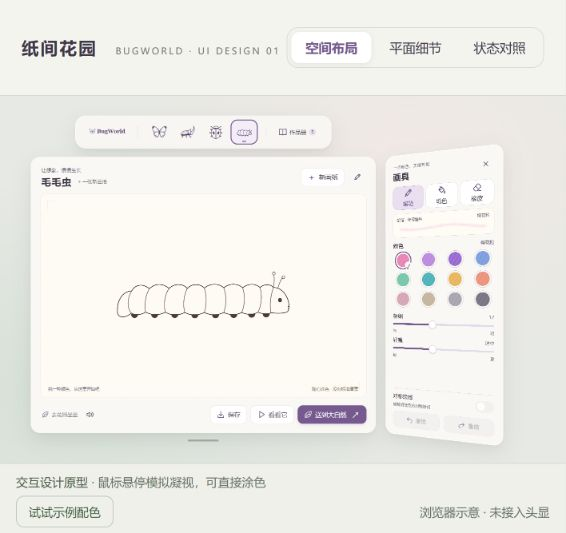
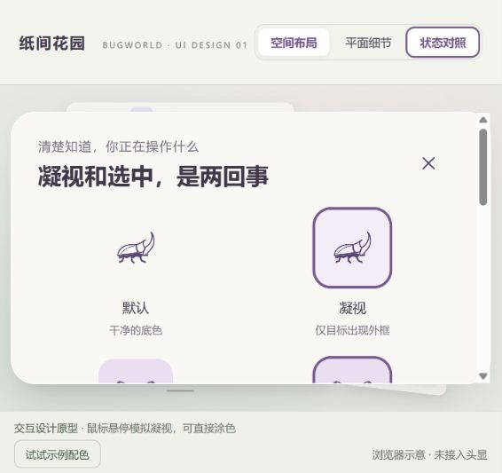

# BugWorld UI · 第一轮交互原型

日期：2026-10-28。**待用户视觉确认；尚未移植原生 UI、未生成新 APK。**

## 查看

在 BugWorld 根目录运行：

```powershell
node docs/ui-redesign/bugworld-studio/serve.mjs
```

打开 <http://127.0.0.1:4178>。无需安装依赖。服务只绑定本机，按白名单读取现有画纸和图标；本轮没有复制大型资源。





## 本轮变化

- 保留暖白浅紫、现有昆虫轮廓、顶部原生栏的布局关系、右侧 25° 附属画具。
- 按本轮用户反馈，顶部四种昆虫使用纯图标，移除可见文字；保留无障碍名称，独立凝视外框与持久选中标记分开。
- 主画板区分状态、次要入口及保存／预览／放生的优先级。
- 画具增加笔触示意、颜色名称和选中勾；不同工具只开放有效参数。
- 用可操作原型检验切纸、草稿、保存和出错状态，而非只提供一张设计图。

## 验证记录

| 检查 | 实际结果 |
| --- | --- |
| JS 与本地服务语法 | 两个 `node --check` 退出码 0 |
| 页面资源 | 26 个引用 HTTP 200，含四种正式画纸、区域遮罩和已有图标；见 resource-checks.json |
| 四种画纸 | 逐一点击，标题和选中状态对应，无误开选择弹层；切回蝴蝶保留草稿 |
| 纯图标导航 | 按最新反馈移除四个昆虫的可见文字，48 px 图标居中；浏览器确认独立选中，无障碍名称保留 |
| 绘画 | 浏览器实际拖画，蝴蝶两翼出现镜像笔触；区域填色可见 |
| 撤销／重做 | 操作后按钮可用状态正确，恢复笔触；未保存换纸出现确认，取消保留画作 |
| 保存及作品册 | 检查保存中禁用、完成提示、缩略图、新画纸后继续编辑恢复原图 |
| 保存失败 | 评审入口注入一次失败，原图保留，有明确重试；重试后保存成功 |
| 冷启动原型 | 页面重载后新空白画纸，作品册记录保留 |
| 画具显隐 | 主画板开关可收起和重新展开画具 |
| 状态及布局 | 先在 1280 × 720 检查空间布局与可滚动平面细节，后在当前 566 px 宽侧栏确认纯图标；保存截图为最新侧栏视图 |
| 预览 | 弹层明确显示二维过渡示意及原生承接说明，未冒充真实 3D |
| 放生衔接 | 点击后先显示保存中，随后显示场景就绪后的流程示意；该动作不会打开真实 Stage |

上述是本地浏览器的语义、交互及视觉检查，不能替代 PICO 凝视、空间角度和帧率验证。没有调用 OpenDesign 云端，也未安装 OpenDesign 应用；实际采用的是其开放设计包结构、状态覆盖和动效规则。原型样例笔触不是原生蜡笔算法的质量证明。

## 过程中的问题

- Browser skill 的旧连接报 `browser-client is not trusted`，没有继续使用该通道；改用可用的浏览器控制工具完成检查。
- 第一轮画具控件累计高度超过 840 dp 的设计容器。先缩减分组间距和笔触预览高度，再将可点击颜色／历史按钮保持至少 48 px；最终浏览器截图中底部完整。
- 平面放大视图中，变换容器产生无用的横向滚动区；仅隐藏横向溢出，保留向下滚动查看细节。
- 指标提取两次未找到请求起点：误假定存在 `event_msg/user_message`，第二次仅修改字符编码仍失败。检查日志类型后发现真实记录为 `response_item/message/role=user`，取实际时间 `07:54:54.180Z`；未用猜测时间代替。

## 下一步与确认项

请确认这版暖白浅紫的细化、画板操作层级、右侧画具密度，以及凝视/选中区别。确认后仅移植对应原生组件，保持现有窗口和场景生命周期；再交付头显对照。作品册完整重设计和更多昆虫入口作为后续范围。

设计及原生映射：[DESIGN.md](DESIGN.md)。时间和可观测 Token：[review/usage.json](review/usage.json)。
