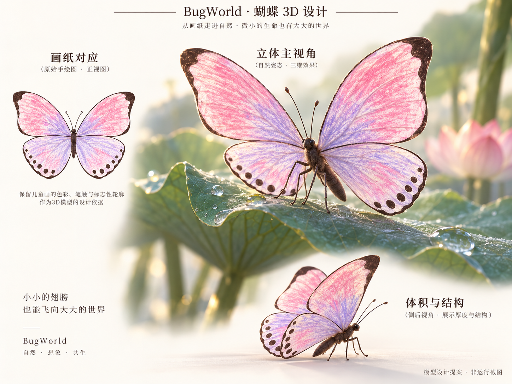
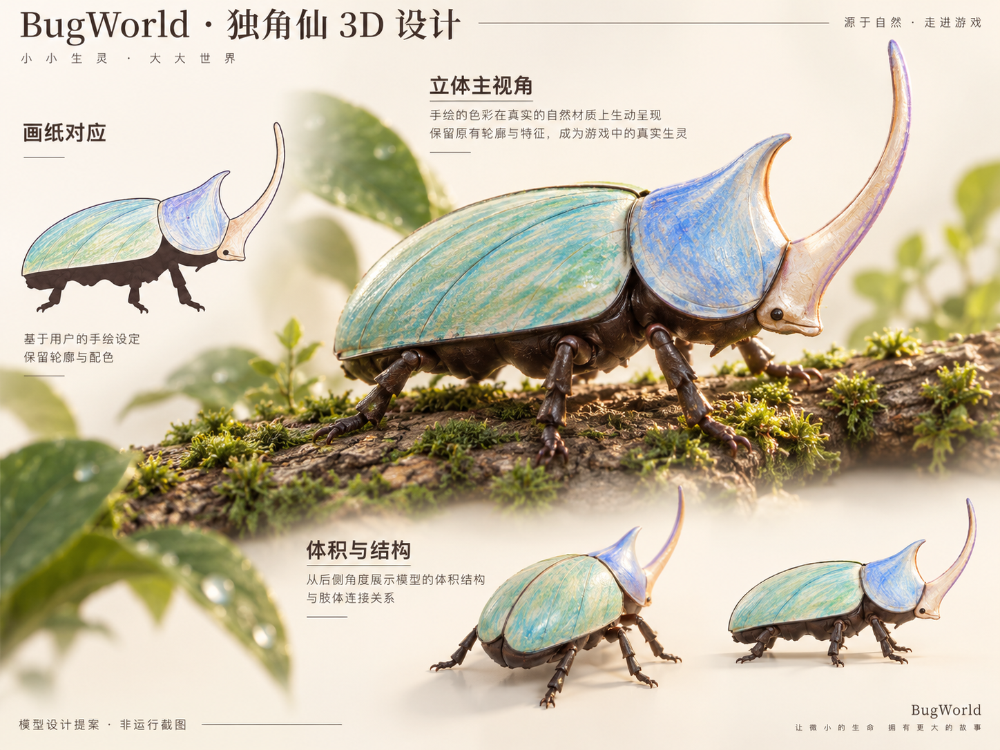
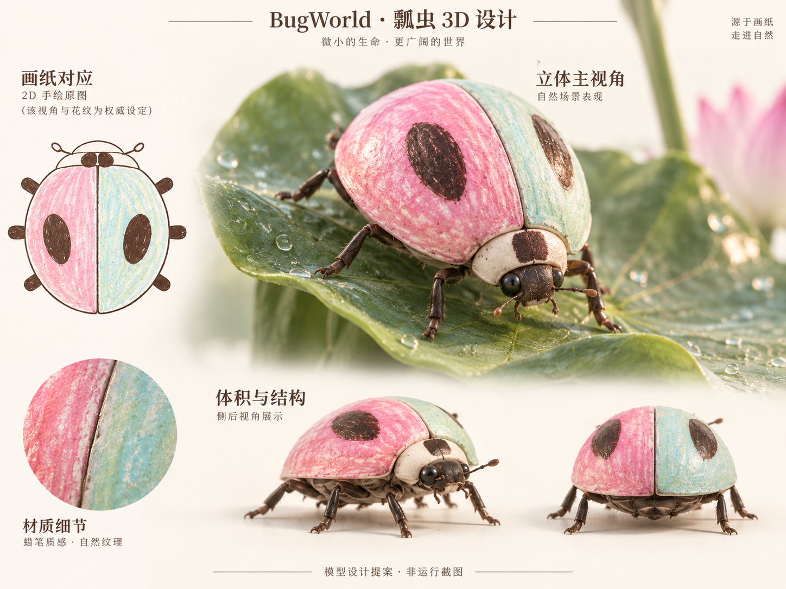
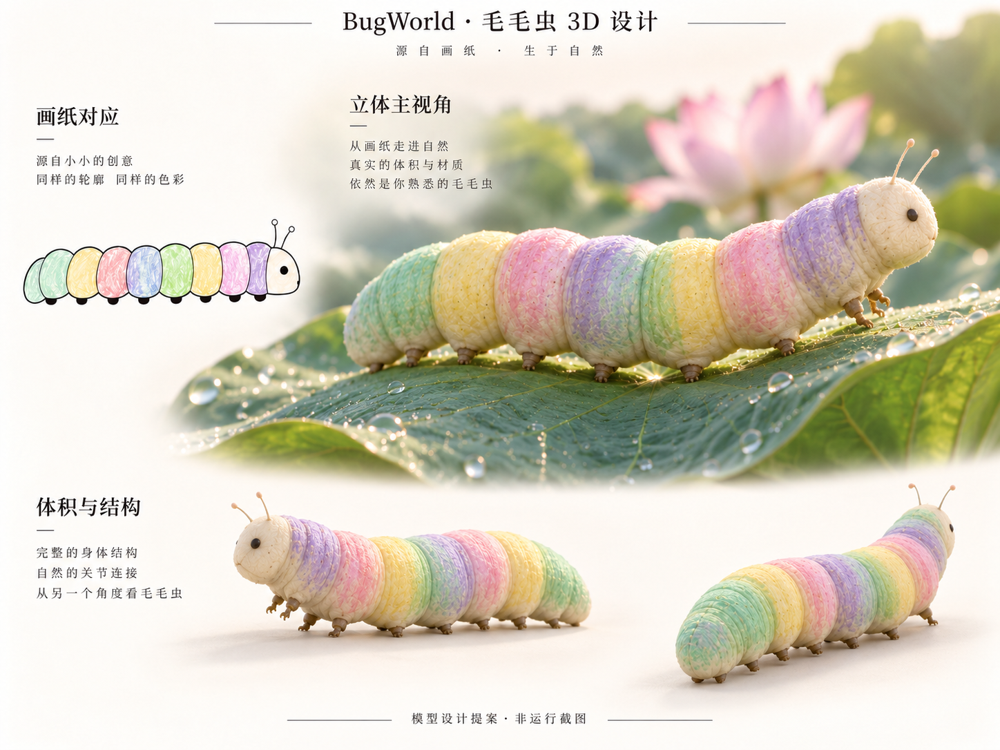

# BugWorld 昆虫 3D 模型设计

> 2026-10-08｜四类模型设计已获用户确认，并授权实施。下列仍是设计图；实际模型、渲染与验证见 [V2 实施结果](../../V2-Implementation-Results.md)，动画见 [动作与绑定设计](../../Insect-Animation-Design.md)。

## 1. 统一目标

**保留玩家画的那只昆虫，同时让它拥有自然生命的体积、材质和姿态。**

- 以已确认的 [四类画纸](01-insect-sheets-v1.png) 为造型基准。蝴蝶／瓢虫在俯视展开方向、独角仙／毛毛虫在侧视方向对齐画纸轮廓、比例与标记；换角度后可以看到合理的身体厚度、曲面与腹部。
- 3D 立体感来自模型曲面、薄翅、甲壳、关节、接触阴影和自然动作。绘画的色彩、留白、蜡笔颗粒和笔痕仍是表面图案。
- 腿与触角有清晰的连接关系；足部贴合叶片／树皮。细节服务于轻松近观，延续已确认的温馨气氛。
- 图中粉紫、薄荷绿等为涂色示例，不固定玩家配色。Shared Space 预览与 Stage 使用同一模型、图案和材质基础，分别适配观察光与暮色环境光。
- 图中植物仅用于表现比例、接触与自然姿态；场景仍按已确认的蓝紫荷塘稿制作。

## 2. 蝴蝶

- **保持：** 宽阔上翅、圆润下翅、上翅深色角边、下翅沿边斑点、细长身体与触角。
- **立体化：** 翅膀有细微厚度和柔和曲率；胸腹为完整体积，细腿自然支撑，翅根能够开合。翅膀轮廓处的深色线转化为表面色带。
- **图案：** 左右四片翅分别映射画稿；正反面延续同一作品的纹样，不额外生成自然物种花纹。蜡笔纹理在开合和观察背面时保持连续。
- **动作依据：** 停在叶缘时翅膀轻轻开合；起飞、转向和落下有连续姿态变化。

## 3. 独角仙

- **保持：** 朝右侧面的长背甲、头甲、向前上方弯曲的长角、深色腹部和短腿布局。
- **立体化：** 补足背甲宽度、成对甲片与中缝、角根到角尖的渐变、腹部和足部关节；侧面投影仍与画纸对应。
- **图案：** 背甲、头甲、角按画纸分区贴图。侧面未画出的曲面延续相邻颜色和已有笔触，接缝避开主要观察面；细腿与腹部使用协调的默认材质。
- **动作依据：** 身体重量压在树皮上，足部交替支撑；触碰时停步、摆动触角或轻微抬起前身。

## 4. 瓢虫

- **保持：** 纵向椭圆轮廓、中央甲缝、左右各一个大长椭圆斑点、小头与侧足。斑点布局以画纸为准。
- **立体化：** 背甲为圆润隆起的完整壳体，腹面相对平缓；有自然甲边、小头、细腿和触角。侧视能够明确看出壳体弧度。
- **图案：** 左右甲片对应左右画稿，弧面上仍能认出颜色分界和手绘颗粒；高光帮助看清体积，不能盖过图案。
- **动作依据：** 沿叶脉短步移动，停下时触角轻动；短飞需要对应的甲片开启与飞行翅结构。

## 5. 毛毛虫

- **保持：** 朝右的长条侧影、连续圆润体节、适度大小的头、细触角和下方小足。
- **立体化：** 柔软圆柱形身体，节间有连续皮肤和褶皱，腹面可弯曲贴叶。体节在前后运动中保持连接。
- **图案：** 按节段延展颜色，弯曲与伸缩时控制拉伸；各节的色序与用户画稿一致。
- **动作依据：** 起伏从前向后传递，前端略抬起探索；触碰时轻缩，再慢慢伸展。

## 6. 制作与验收约束

1. **先比轮廓：** 实际模型导出与画纸对应方向的正交视图，叠加检查翅形、角形、背甲比例、斑点和体节；设计图多视角只是美术参考，不当作已校准的正交工程图。
2. **再看立体：** 在中性光下转动检查侧面、背面、腹部和足部接触；近看有曲面与厚薄变化，远看保留纸上昆虫的识别特征。
3. **检查原画：** 使用非对称颜色、圆点和笔划做映射核对；预览、保存重载、入园及动画后保持一致。对空白区域和遮挡区域的补色不能改写用户可见画稿。
4. **检查材质：** 翅膜轻薄、甲壳有克制高光、软体有柔和明暗；蜡笔颗粒可辨认，不因强反光或蓝紫环境光丢失颜色。
5. **检查动作：** 沿植物活动、转弯、停留、受触碰和离开时，身体结构、接缝与纹理保持自然；避免脚滑、穿叶和关节分离。
6. **以真机为准：** 最终评审展示实际模型转动和近处观察，结合 Stage 满员 10 只的运行表现。概念图不能替代交付模型的画质与性能证据。

## 7. 制作记录

四张模型设计图使用内置 `image_gen.imagegen`，依据已确认的画纸稿及荷塘稿生成；原始输出保留，项目中保存版本化副本。完整提示词见 [imagegen-prompts-models.json](imagegen-prompts-models.json)。

本轮确认范围仅为四类昆虫的立体造型与自然感，已确认的画纸、Stage 和多窗口 UI 不重复确认。图中说明文字是评审注解，不属于应用界面文案。
