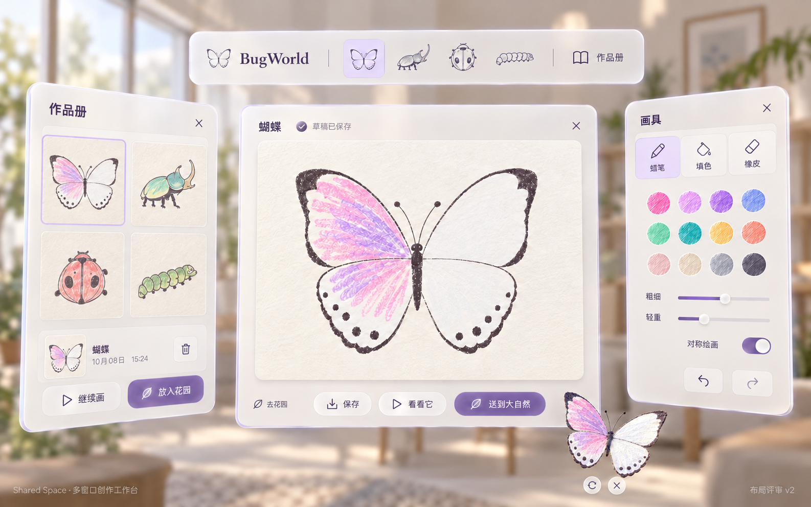
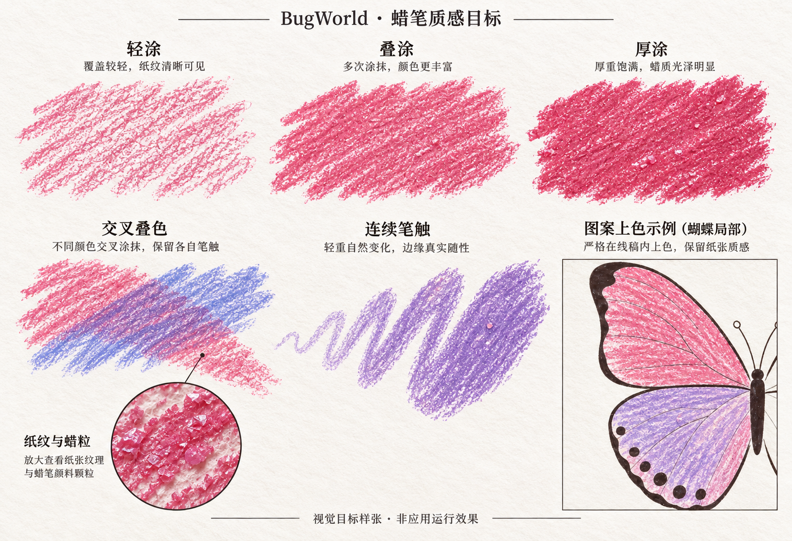

# BugWorld 第二轮设计 · 多窗口与蜡笔

> 2026-10-08｜画纸、Stage 和本页新版多窗口 UI 已获用户确认。用户新增要求：昆虫 3D 模型先出设计图，保留画纸轮廓并具备自然立体感；见 [模型设计](Model-Review.md)。应用代码尚未修改。

## 1. 已确认，不再重选方向

- **昆虫：** 按 [已确认的四类昆虫稿](01-insect-sheets-v1.png) 制作画纸、遮罩和对应模型，保持稿中的轮廓、斑点与比例。
- **Stage：** 按 [已确认的荷塘稿](03-stage-lotus-v1.png) 制作；实现还原度是重点验收项，不能只满足“荷叶、树、水面都存在”。
- **UI 风格：** 暖白、浅紫、清晰留白已认可；布局改成真正独立的空间窗口。
- **原有规则：** 单机、四类昆虫、无命名、作品册长期保存、花园最多 10 只、场景就绪后再播放新昆虫出场。

## 2. Shared Space 多窗口布局

| 空间位置 | 独立容器 | 内容 |
| --- | --- | --- |
| 上方 | 导航条 WindowContainer | 从左至右：BugWorld logo／文字 → 蝴蝶、独角仙、瓢虫、毛毛虫图标 → 作品册按钮 |
| 中央 | 绘画 WindowContainer | 当前画纸与保存状态；底部保存、看看它、送到大自然，保留直接去花园入口 |
| 右侧 | 画具 WindowContainer | 蜡笔／填色／橡皮、颜色、粗细、轻重、对称、撤销／重做 |
| 左侧 | 作品册 WindowContainer | 点击上方作品册按钮后出现；缩略图、选中作品、继续画、预览、放入花园、删除 |
| 中央前方 | 立体预览内容 | 当前预览对象的真实 3D 模型及转动／缩放／关闭操作；不遮住按钮或画纸 |

前三个创作窗口默认打开；作品册按需打开、可关闭。各窗口之间保留空隙，左右面板在默认布局中朝玩家微微内收；示意图同时展开作品册以展示关系。预览仍需支持缩放，图中小控件只示意旋转与关闭。

### 窗口与状态行为

- 主画纸是默认布局的参照；画具右侧、作品册左侧、导航条上方。各容器可独立移动，不把一个大窗口内的卡片当作多窗口。
- 同一窗口重复点击只恢复／聚焦已有实例；关闭画具或作品册不丢草稿。用户移动后的窗口不因一次涂色或刷新被强制摆回。
- 顶部昆虫选择与中央画纸、右侧对称等控件同步；有未保存内容时切换物种保留现有保护机制。
- 作品册的选中作品、中央草稿、当前 3D 预览目标分别管理。浏览、删除其他作品、放生已保存作品不会静默覆盖中央草稿；只有“继续画”才明确切换编辑对象。
- 已打开当前草稿预览时，新的笔触同步到预览；预览作品册里的历史作品时，中央涂色不会修改该历史作品。
- 进入 Stage 前记住哪些辅助窗口打开；返回后恢复同一编辑状态与窗口集合。部分窗口打开失败要提示，不影响草稿保存。
- 半透明只用于窗口边框和轻背景；纸张不透底。字号、点击面积、间距和最大展开宽度以头显可读性与转头负担校准。

## 3. 蜡笔：重做颜色沉积方式

**目标：接近真实蜡笔在纸上的视觉效果，包含纸纹、蜡粒、擦过纸面的方向性，以及反复涂抹后的颜色堆积。** 样张是 imagegen 生成的质感目标，不是画笔程序运行结果。最终以实际连续绘画、保存后的图案以及模型表面的表现验收。

### 第一版的具体问题

`PaintDocument.stamp()` 每个印章以 0.70–0.96 的 alpha 混入颜色，圆形印章反复重叠，很快趋近实色。现有随机值只改变覆盖率，没有纸面高低和蜡质堆积；`PaintView` 只处理当前触点，未利用历史触点，绘画资源分辨率为 512。以上是代码检查结论，尚未修改。

### 新版实现约束

1. **纸纹固定在画纸上：** 同一位置的纸面纹理保持稳定，缩放、预览、撤销、重载不重新随机；纹理由细颗粒与较大的纸纤维起伏组成。
2. **轻涂留白，叠涂积色：** 用纸面接触与当前沉积量控制新增颜色。单次轻扫露出纸纹；多次擦过逐步填满部分凹隙，不一笔变成实心色带。
3. **笔触连续：** 按实际移动距离均匀采样，衔接触点历史；笔头具有不规则轮廓和沿运动方向的细痕，避免串珠、断点和重复印章边界。
4. **两种颜色有叠涂层次：** 后一色覆盖高点，部分前一色从纹理间显露；保留各自方向的笔痕，避免把颜色均匀糊成一块。
5. **轻重可控：** 右侧加入简洁“轻重”控制，空中手势也能画出轻／重涂效果；只有设备提供可靠压力值时才接入，不能把普通捏合伪装成真实压力。
6. **显示与保存一致：** 草稿、作品册、3D 预览和 Stage 使用同一份已沉积的图案；轮廓作为独立清晰层。提高纹理分辨率时同步检查绘制延迟和撤销内存，避免只放大模糊的 512 图。

画笔先用实际实现生成与样张对应的“轻涂／叠涂／厚涂／交叉叠色／连续曲线”，再放到蝴蝶上验收。测试笔画拆成不同数量输入事件时不应出现明显深浅变化；撤销／重做、镜像、边界和保存重载必须保持一致。

## 4. Stage 如何对照设计稿验收

| 设计稿中的关键效果 | 实现与检查重点 |
| --- | --- |
| 有卷边与叶脉的巨型荷叶 | 真实曲面轮廓、正反面、叶脉纹理／法线、层次丰富的绿色；转头后仍有立体厚薄与视差 |
| 近景枯木与苔藓 | 破口轮廓、树皮裂纹、粗糙度和附着苔藓；近距离不出现纯色光滑圆柱观感 |
| 芦苇与荷花形成的湿地 | 高低、朝向、疏密有变化，保持视野通道与昆虫活动路线 |
| 蓝色水面与蓝紫纵深 | 可见细波纹和柔和反光；前、中、远景明暗与色温分开，不能只用一片纯蓝平面 |
| 微光与手绘昆虫 | 暖色萤火稀疏、局部柔和；昆虫的蜡笔色彩清楚，避免整体蓝光染色 |

采用精细近景模型、颜色／法线／粗糙度／遮蔽贴图与预烘焙细节；中远景复用资源并逐级降低细节。已从本地 **SDK 6.1.0** 的 `PhysicallyBasedMaterial` 核实这些贴图接口存在，但实际材质、光照和水面效果仍需在设备上验证，不能以 API 存在代替画面达标。

### 实施顺序与证据

1. 在真实 Stage 中做出完整主视角：一组近处荷叶、枯木、苔藓、荷花、水面与远景，按相同观察位置截图对照已确认设计稿。
2. 核对轮廓、构图、亮度、色彩和材质细节；先让静态主视角达到要求，再扩展周围空间。Blender 离线预览只辅助制作，不能代替头显画面。
3. 加入轻微植物运动、水纹和萤火，再加入 10 只昆虫、出场特效和声音；检查最终画质、稳定性和持续运行表现。
4. 性能优化优先处理不可见部分、远处细节、贴图和重复资源。若必须改变近景质量或设计表现，先展示实际差异，再讨论取舍。

验收证据需要包括：同视角概念图／真机截图对照、转头时的立体效果、近处昆虫蜡笔细节，以及满员时的实测表现。当前尚无新版真机画面，不声称已还原。

## 5. 本轮确认范围

画纸、Stage 和本页多窗口布局均已确认；蜡笔改进列为必须实施的质量项。新增 [昆虫 3D 模型评审](Model-Review.md)，只确认模型的立体造型与自然感，不重复选择已确认的设计方向。

完整图像提示词见 [imagegen-prompts-v2.json](imagegen-prompts-v2.json)。使用内置图像工具，输出为评审素材，不作为运行截图。实现阶段继续使用 SDK 6.1.0 与 `codex/bugworld-v1` 分支，并记录 PICO CLI、时间和可核实 Token。
