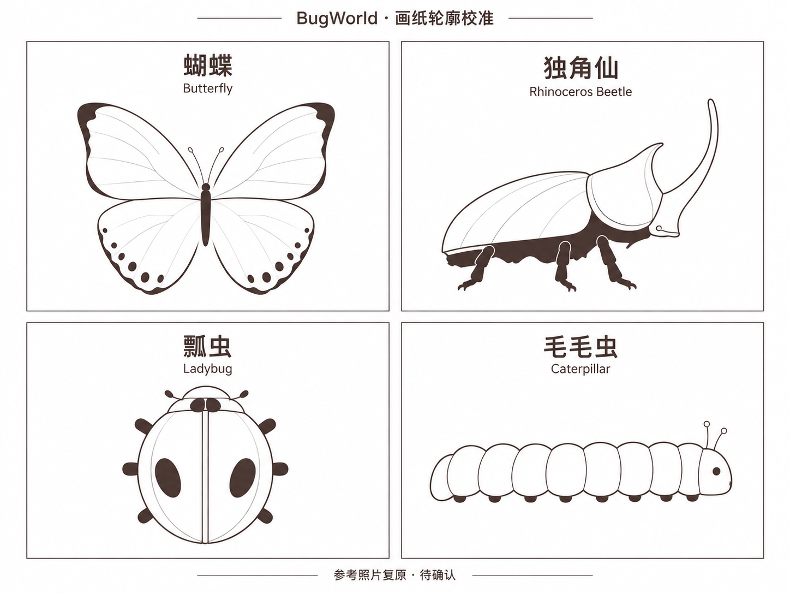
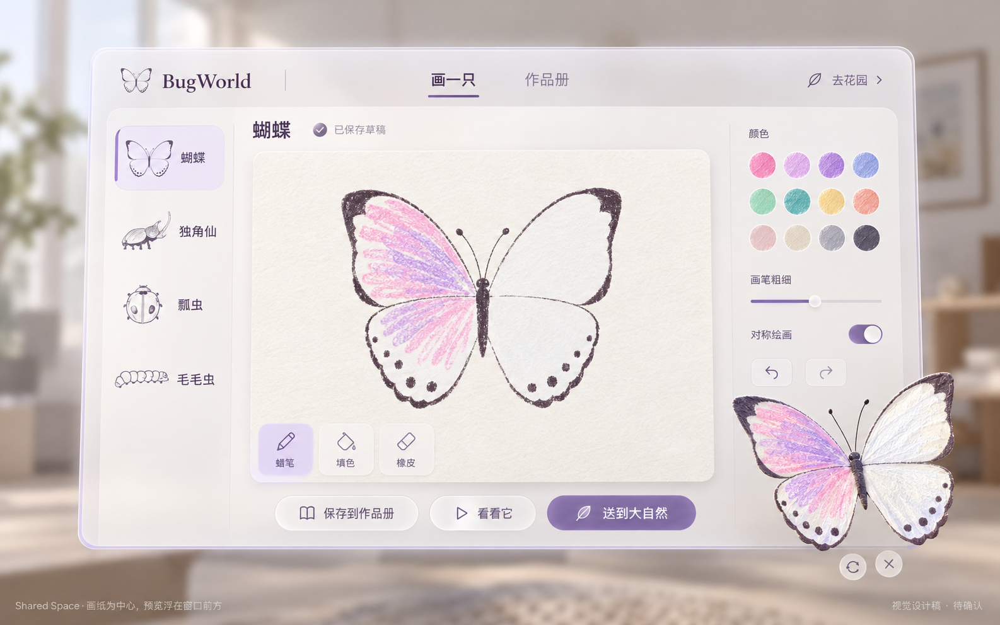
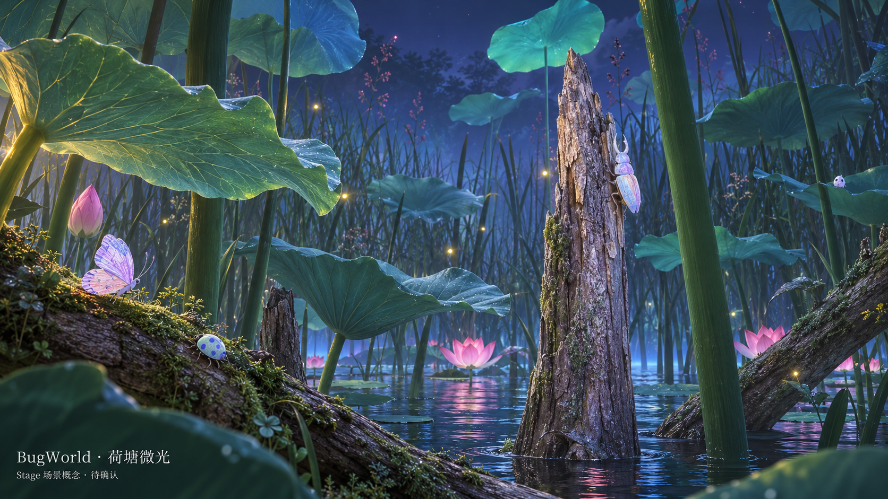

# BugWorld 视觉重设计 · 第一轮评审

> 2026-10-08｜历史第一轮提案。用户已确认昆虫稿与 Stage 稿、认可浅色 UI 风格，并要求改为多窗口及提升蜡笔效果；最新状态见 [第二轮设计](Review-v2.md)。本文保留首轮方案和排查依据。
> 用户要求：画纸贴合原照片；Shared Space UI 重设计；Stage 按现场视频重做。以上三项确认后实施。

## 1. 昆虫画纸

以用户第二张照片为轮廓依据，保留四类昆虫和原有观察角度，不增加拟人表情。

| 昆虫 | 必须保留的识别特征 |
| --- | --- |
| 蝴蝶 | 正面展开；宽阔上翅、圆润下翅、上翅深色角边、下翅沿边斑点、细长身体 |
| 独角仙 | 朝右侧视；长背甲、分开的头甲、向前上方弯曲的细长角、下方短腿 |
| 瓢虫 | 俯视纵向卵形；中央甲缝、左右两个长椭圆斑点、小头与侧足 |
| 毛毛虫 | 朝右侧视；横向连续的柔软体节、下方小足、细触角 |

此图用于确认轮廓方向，不直接当作最终涂色模板。定稿需对照照片逐条校正轮廓、斑点位置、线宽和体节比例，减少示意稿里新增的翅脉／甲壳装饰线。纸张边缘、标题和界面文字不进入昆虫贴图。正式画纸、遮罩和 3D UV 必须配套，保留用户笔触与留白；旧作品按模板版本保留，不能直接套新 UV。

## 2. Shared Space

**暖白画纸为中心，浅紫强调操作，空间中的昆虫是预览主角。**

- 顶部：画一只／作品册，右侧可直接去花园。
- 左侧：四类昆虫；中央：大画纸；右侧：颜色、粗细、对称与撤销操作。
- 底部：保存到作品册、看看它、送到大自然；工具与主要按钮保留足够的手势点击面积。
- “看看它”后，昆虫出现在窗口前方略偏右下的位置，有明确体积和视差，不遮住画纸及主按钮。支持转动、缩放与关闭；随窗口移动时保持相对位置。
- 作品册延续同一配色、留白与圆角规范：以原画缩略图为主，详情提供继续编辑、预览、放入花园、删除；删除保留确认。
- 图中半透明程度、昆虫大小与前后距离通过头显调整，以文字清晰、舒适和操作可达为准；画纸保持不透底。

## 3. Stage：荷塘微光

**从昆虫尺度进入蓝紫暮色的荷塘。** 以附件的荷叶、芦苇、枯木、荷花和蓝色水面为基础，融合此前确定的微光与萤火氛围。

| 层次 | 视觉与用途 |
| --- | --- |
| 近处 | 有卷边、叶脉和厚薄变化的大荷叶；苔藓枝条；观察、出场及触碰互动位置 |
| 中景 | 具有树皮细节的枯木主干、交错枝条、零星粉色荷花；可辨认的爬行路线 |
| 远景 | 高低芦苇、荷叶剪影、蓝色水面、靛紫薄雾，形成连续空间深度 |
| 光线 | 青蓝叶片、蓝紫远景、少量暖色萤火和近处补光；保留涂色原本颜色 |

场景图是美术目标概念，不是已经运行的头显截图，也不代表已验证的实时画质。主体轮廓、前中后景、树皮与叶脉细节是验收依据。正式实现先完成一个可在真机检查的局部场景，再扩展全场；资源使用有机曲面、贴图和分层细节，不继续沿用第一版几何体拼装的视觉。

图中的昆虫只是尺度与蜡笔质感示意；正式模型轮廓和斑点以第 1 节与原照片为准。场景布局覆盖周围可观察方向，概念图仅展示主视角。

## 4. 新昆虫出场

**保存成功 → 打开 Stage → 场景资源就绪且用户已能看到场景 → 出场光效与声音 → 昆虫显现 → 自然活动。**

1. 加载期间显示简短进度反馈；“放生请求”独立保存，尚不生成新昆虫。
2. 场景、模型、作品纹理和短音效准备完成，Stage 已可见后，选择前方可见的叶片或树干位置；不在玩家身后生成。
3. 柔和粉白光点汇聚，展开一小团微光粒子；随亮度上升播放短促、有方向感的铃音，昆虫从亮点中清晰显现。音乐轻微让位，让人知道新生命出现在哪里。
4. 昆虫停留约 2–3 秒展示图案，再爬行或起飞；这是拟定节奏，实施时对照参考与头显调整。
5. 同时最多 10 只：满员时，在场景就绪后先让最早一只退场，再执行新昆虫的完整出场。反复点击去重；取消／失败不丢作品，不提前淘汰旧作。普通重进花园不为所有旧昆虫重复播放出场特效。

“打开 Stage 返回成功”不能代替“场景已显示”；不能只靠固定等待几秒掩盖加载问题。

## 5. 音乐检索

- 照片上的 `meland × Arte kids park` 与官方 **Live Sketchbook** 昆虫绘画项目吻合，是目前找到的来源线索。[Arte Kids Park 官方项目页](https://cn.artekidspark.com/)
- 官方公开页面未找到可核实的具体曲名、作曲者或下载音源，也未找到该曲可用于应用的公开授权。因此**尚未识别原曲，不能确认可直接复用**；没有把 ARTE MUSEUM 其他展览的配乐当作本项目原曲。
- 可向项目方询问 Live Sketchbook／Meland 荷塘场景的 BGM 曲名、音源与应用使用授权；官方商务联系为 `artekidspark@dstrict.com`。[官方联系页](https://www.artekidspark.com/contact)
- 下一版音乐方向：保留梦幻感，增加清晰旋律和轻盈律动，避免第一版过慢、持续拖长的音色。最终曲目需试听确认；这不是对原视频 BPM 或配器的识别结论。

本轮已读取 15.2 秒视频的画面并提取本地音轨备查；未取得音频指纹匹配结果，没有将附件原声打包进应用，也未向项目方发消息。

## 6. 预览与切换排查

| 已见证据 | 判断与后续验证 |
| --- | --- |
| `Main.kt` 使用 `Placement.right(it, 24.dp)` 打开独立预览容器 | 位置配置明确不符合“窗口前方”；尚不能据此断言完全不显示的唯一原因 |
| `openWindowContainer` 结果未反馈到界面 | 增加打开结果、容器生命周期和模型可见性日志；失败应有可见提示 |
| `place()` 先更新花园队列，再进入 Stage；场景 tick 直接生成队列昆虫 | 缺少场景可见就绪与单次出场请求的协调，需要重做入场时序 |
| 已连接真机日志出现 `There is no stage open`、`There is no matched window` | 窗口最小化／恢复存在失败记录，不能仅改坐标就宣称预览问题解决 |
| 真机记录 `LookAtComponent_nativeSetViewerAsTarget` 的 `Entity nullptr` | 核查组件绑定时机；此错误属于 Stage 相关证据，不冒充预览故障根因 |

本轮只读取已连接设备上的本应用日志，没有修改、重装或宣称修复。实施时须验证：打开预览、关闭重开、切换物种、更新画作、移动窗口、进出 Stage 后再次预览。

## 7. 确认与实施边界

第一轮结论：**昆虫设计稿、荷塘 Stage 设计稿已确认；UI 风格已确认，布局改为多窗口**。以 [第二轮设计](Review-v2.md) 为当前要求，避免继续按本页旧的单窗口布局制作。

保留已经确定的单机、四类昆虫、作品册、最近放入的 10 只、无命名、轻量手部互动等规则。异步共享和顺序／随机轮换仍是后续范围。

## 制作记录

- 三张评审图由内置 `image_gen.imagegen` 基于用户参考图生成，已经逐张检查；不替代模型、贴图、Compose 布局或真机验证。
- 完整提示词与参考文件名见 [imagegen-prompts.json](imagegen-prompts.json)；原始输出保留，项目内使用版本化副本。
- 第一张为轮廓校准提案；第二张为 UI 概念；第三张为场景气氛与构图目标。最终效果需按确认的设计制作实际资源。
