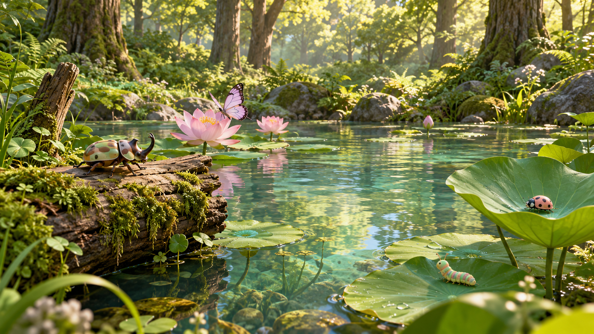

# BugWorld · 碧绿森林场景设计

2026-10-20。根据用户最新反馈整理，沿用现有 Stage、画板、作品册和互动流程。

**已确认方向**：用户于 2026-10-20 接受下方概念方案，要求优先场景设计、还原度与复杂度控制。现有 1.0.11 用户确认已无卡顿，HUD 约 46 FPS，可暂时忽略该数值；不是 72/90 FPS 达标。后续改版至少保住当前体验，90 FPS / 11.11 ms、72 FPS / 13.89 ms 留作监测目标。

**视觉目标**：围绕玩家的小型森林池塘，温暖、明亮、可近距离观察；保留真实阴影和批准的昆虫模型。以概念图逐项核对构图、光色、材质、水面和空间密度；不将“100% 还原”误写成已证明的概念图与真机像素一致。

这张图由内置 imagegen 生成，仅表达森林色调、材质和构图方向，不是 Blender 实际资产或真机截图。图中昆虫为气氛示意，运行资产继续以用户批准的四种模型为基准。[生成提示](imagegen-prompt.json)。

## 1. 森林与天空

- 建议清晨：碧绿树冠、苔藓绿中景、浅青空气感，少量暖阳和可辨的树影。
- 将背景、环境照明和水面反射作为一套更新，避免只换天空图片而物体仍沿用蓝紫夜间照明。
- 近处实体少而精；远处森林主要由背景与低成本轮廓形成包围感。保留树冠空隙和水面开口。
- 四个方向都审查，不能只通过一张正面效果图。概念中的水下景物和远景细节需按性能预算取舍，不将其直接写成已实现效果。

## 2. 有轻微流动的水

当前 `SceneLighting.applyToGarden` 只配置固定 PBR 参数与静态环境反射，没有持续的水面动画。

- 首选材质动效：两层不同方向、不同尺度的法线缓慢移动，形成不规则细波；反射随法线自然变化。
- 保留低频、低振幅，避免整块水面移动、塑料亮片、金属镜面和重复条纹。岸边及木头入水处用柔和过渡帮助判断水位。
- 优先使用一个水面绘制与共享纹理；不每帧重建网格或上传 Bitmap。
- 本地 6.1.0 已核对 `ShaderGraphMaterial` 的 bundle 加载与参数接口；实际节点、法线合成、反射和运行兼容性需在 Spatial Editor 小样中验证。
- 水材质增量 GPU 预算初值 ≤0.5 ms，必须真机 A/B 验证后才保留。不是流体物理模拟，也不能预先保证不占资源。

## 3. 面向玩家的近处布局

- 以进入场景时的玩家中心和眼高检查，兼顾坐姿/站姿，不以世界原点代替眼睛。
- 背后观察叶降低，叶面朝中心倾斜；左右叶片调整方位，避免只见叶背或叶缘挡住半只虫。
- 互动叶面以斜向上为主，不把所有叶片竖直翻向玩家；植物仍应自然生长。
- 木头进入岸边或水面；附近的木面、叶面和伸手空间互不穿插。
- 布局变更后重采样真实表面路线、法线与起落净空，之前的路线坐标不能继续直接复用。

## 4. 按物种布置固定循环轨迹

目前代码已有采样路线，但分配主要按通用 slot；只有部分毛毛虫 slot 选择木面，独角仙也会落在荷叶。这与本次要求不符。

| 物种 | 主要行动表面 | 默认循环 |
| --- | --- | --- |
| 独角仙 | 宽倒木、树干上可见的缓坡 | 起点出生 → 沿木面单向爬行 → 绕过缓弯 → 连续回到起点 |
| 瓢虫 | 朝向玩家的荷叶、可见短叶柄 | 起点 → 沿叶脉走动 → 停留 → 沿闭合路线返回 |
| 毛毛虫 | 低叶面、苔藓木面 | 起点 → 缓慢蠕动 → 抬头探索 → 连续绕回起点 |
| 蝴蝶 | 花/叶停栖点与其间的空中路线 | 起点停栖 → 起飞 → 沿固定弧线飞行 → 另一落点停留 → 返回 |

- 路线预先定义物种、支撑表面、起点、方向、速度、停留点和闭环接缝；起终点位置及切向连续，不瞬移回起点。
- 爬行速度按路径距离控制；身体方向跟随切线，俯仰/侧倾跟随实际表面法线。
- 新虫在所分配路线的起点出生，仍等待场景准备好，再播放入场光效与声音。为不同物种提供前方可见的迎新路线，独角仙使用前侧倒木。
- 同一路线错峰进入，避免起点堆叠；上限仍为 10 只、FIFO 淡出。
- 触碰或手部邀请暂时中断路线，互动结束后平滑接回；固定路线不妨碍手势互动。

## 5. 验收次序

1. 绿色森林的色调与空间密度已确认；不再重复询问相同方向。
2. 实际场景资产四向渲染，检查所有观察叶、木面和路线净空。
3. 真机单独验证水材质和照明，再接入路线；保留当前可用包。
4. 0/1/5/10 只、转头一圈、伸手互动、连续运行分别测量；同时看实际 FPS、GPU P95/P99 和异常长帧。

森林风格、水面动效和新路线尚未接入安装包。先制作真实资产、四向实景与复杂度报告，再进行运行材质验证；1.0.11 的证据另见 [性能记录](../../Stage-111-Performance.md)。

## 6. 真实资产设计的约束

| 层级 | 实现与范围 | 预算 / 检查 |
| --- | --- | --- |
| 互动近景 | 六片主要观察叶、四片小浮叶、三朵花；一根倒木、一根入水枯木，原木头尺度保留 | 原始纹理和近景轮廓优先；触点必须来自导出后的实际表面 |
| 岸边 | 不规则低岸、少量苔石、28 组低蕨、24 根低草 | 岸线随观察叶边界让开，主要位于 4–5.7 m；不用高密草墙包围玩家 |
| 远景 | 单张 360° 森林全景与一个背景壳体 | 背景网格 ≤4,096 三角形；贴图与 IBL 方位一致；左右接缝、上下极点需检查 |
| 花园几何 | 不含昆虫，连同岸边、植物和木头 | 目标 ≤160,000 三角形，上限不超过当前 175,176；面数不代替实测 |
| 水面 | 一张面、静态材质小样先确定色泽，再验证双层流动法线 | 2 三角形；新增 GPU 开销目标 ≤0.5 ms，不能用离线倒影证明运行效果 |
| 灯光 | 一盏主日光的可见阴影 + 与背景匹配的环境光 | 不为每朵花/每只虫新增投影灯；不用仅 Blender 支持的景深、体积雾掩盖问题 |
| 纹理 | 沿用现有木头、昆虫的近景纹理，新增森林背景和地面图 | 新增解码后含 mip 纹理预算初值 ≤64 MiB；以实际尺寸统计 |

初始眼高按站姿 1.65 m、坐姿 1.15 m 审查，用户中心 `(0,0)`。后侧主叶中心高约 0.30 m，左右主叶约 0.20–0.55 m，前侧低叶约 0.12 m。各片叶片法线朝上并略偏中心，避免侧着或背对玩家；叶面能见不代表虫体无遮挡，还要检查运动路径的全过程。

**逐项还原清单**：左侧苔藓木头、右侧可观察叶、开阔中央水面、绿色树冠与暖色碎光、自然水岸边界、柔和粉色花、批准的四种昆虫。第一轮实景已发现岸面像平坦草环、近景偏暗，不能标记通过；修订后再检查。所有对照均保留“概念 / 实际 GLB 渲染 / 真机”的标签。

**流畅度保护**：新场景单独保存；部署前保留 1.0.11 APK。真机以相同作品数量对照当前版本的进入时间、转头和伸手体验，以及 GPU P95/P99、异常长帧和纹理内存。用户当前暂不要求追逐 HUD 数字，但不允许引入可感知卡顿。不能通过删掉昆虫动画、关闭所有阴影或把近景换成平面图片获得“通过”。

## 7. 资产试做结论

已制作可编辑 Blender 场景、独立花园/背景 GLB、实际 GLB 重导入四向渲染和接触检查，见 [资产试做记录](../../../assets-src/emerald-forest-review/README.md)。当前仅作为设计可行性与布局检查，**还原度未通过，不接入应用**。

- 近景与岸边共 150,211 三角形，背景 3,968 三角形，仍在预算内。使用当前已确认昆虫资产；固定配色仅用于展示布局。
- 六片主叶均朝向站姿/坐姿中心视点；39 组叶—叶、叶—木头、叶—岸边、叶—石头的实际三角形相交检查为零。这不覆盖虫体全动画、手部或完整循环路线。
- 差距：远景仍偏像背景画、岸边衔接过于规则，水面缺少参考图的通透层次和动态细波。暖阳的斑驳与近景材质也需继续匹配。
- 全景二次生成请求为 4096×2048，实际仍是 **1774×887**，不能当 4K 资产。下一阶段须解决背景清晰度与接缝，再评估真机材质；不靠放大图片伪称获得细节。
- 先保住当前流畅包；等真实资产和材质达到逐项对照要求，再进入应用集成。当前阶段完成的是设计约束与可测的资产试做，不是最终画质交付。

依据：[PICO 材质文档](https://developer.picoxr.com/document/spatial-sdk/material/)、[Spatial Editor 工作流](https://developer.picoxr.com/document/pico-cli/spatial-editor/)。具体能力以本地 6.1.0 和编辑器实测为准。

## 8. 继续修订（第二轮）

用户指出自查未通过不应停工后，继续制作 [第二轮实际资产](../../../assets-src/emerald-forest-v2/README.md) 和 [原生水材质工作台](../../../assets-src/emerald-water-editor/README.md)。当前仍不是最终画质交付。

- 背景已换成原生 8K 摄影素材缩至 4K，带同源 HDR；远处主要树冠仍放在背景中，新增 8 根实体中景树干帮助深度衔接。
- 水面改成 160 三角形不规则池面，避免原 2 面方形水面越过池岸；仍是一个绘制表面。离线法线烘焙加入有效像素断言。
- 花园最新 151,989 面；5 片主叶、12 组扫描石、40 组低蕨。删除被倒木遮住的左侧重复主叶并移动两片前叶，30 组主要表面相交检查为零。全部嵌入纹理 RGBA8+mip 估算约 204 MiB，相对第一轮净增约 60 MiB，落在净增 64 MiB 的初始预算内；原先只算背景和地面不足以代表总纹理成本，已补完整清单。
- 原生双层水波已完成独立编辑器时间对照与移动端编译。法线空间、贴图类型和打包器缺 DLL 的失败/修复记录见复盘 BW-13/14。
- 原生水材质随后已接到整个花园的编辑器场景；背向亮天空的波浪反光过强，继续减小法线坡度并按 12 m 池面重设平铺。石头/花瓣改为显式纹理材质，修正导入差异。记录见[原生材质对照](../../../assets-src/emerald-native-materials/README.md)。
- 岸面外围隆起从约 0.95 m 降至 0.38 m，缓解裸露草坡。阳光阴影与苔藓层次、岸边与森林的一致性仍待细化；编辑器中导入日光 GLB 未获得可确认的灯光组件，不能把离线阴影标为原生成功。尚未替换 1.0.11 运行资产。

## 9. 原生日光与融合修订（2026-10-21）

- 原生 `DirectionalLightComponent` 已在重新打开的独立项目中生效；一盏 2400 lux 日光配合同源森林 HDR。天空球原来参与投影，关闭其投影并用外部引用保存后，背景和近景阴影同时可见。标准 USD 灯光和导入 GLB 的失败没有追认成成功。
- 岸外缘下收、石头改为不规则成组，低蕨修正颜色；8 根辅助树干因抬头露截口而删除。尝试延长树干仍露截口的失败截图保留。当前为 150,789 三角形、37 网格、17 材质；原有近景物体比例保留。
- 水面使用双层时间 UV 驱动细波，0.65 透明度与染色池底形成浅水层次。池底错误使用模型 UV 图集造成黑带，换平铺纹理后消除；不包含物理折射。
- [原生便携项目](../../../assets-src/emerald-native-scene/README.md) 73 文件、127 个相对资源引用；独立打开后六视角已检查，mobile 编译通过。固定相机水域像素变化、背景不变，排除仅移动镜头造成“水在动”的误判。
- 30 组静态相交检查为零；29 个旧运行资产及 1.0.11 APK 不变。几何/编译检查不能代替动画、真机或帧率验收。
- 原生效果已从无可确认日光推进到可保存的完整场景。接下来仍需将此照明/水材质/环境与新路线整体接入应用；固定全景视差、头顶投影模糊、头显材质颜色与性能需要继续验证，未宣称 100% 还原。
